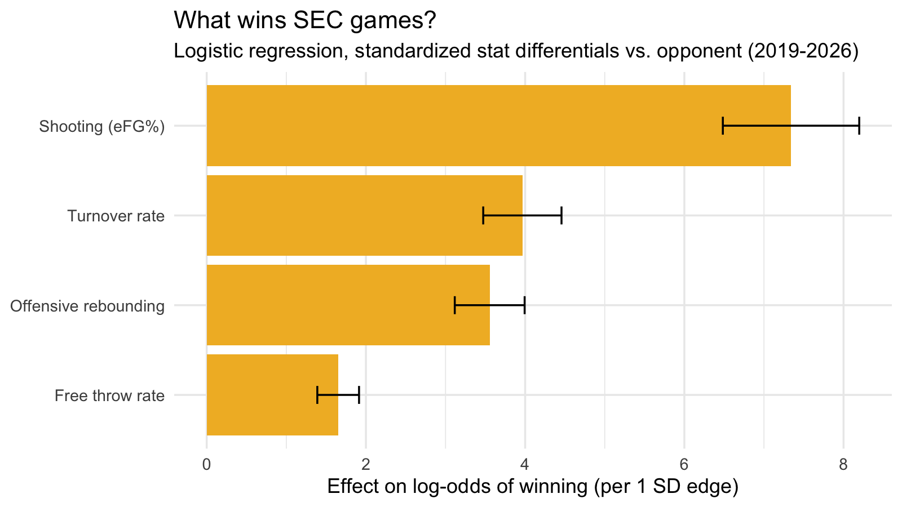

# SEC-Basketball-Win-Factors
# What wins SEC basketball games?

**Question:** Which box-score factors best explain SEC wins?

**Data:** 1,168 SEC games, 2019 to 2026 (ESPN box scores via the hoopR R package).

**Method:** Logistic regression on standardized differentials vs. the opponent for Dean Oliver's Four Factors: shooting (eFG%), turnover rate, offensive rebounding, and free throw rate.

**League-wide finding:** Shooting efficiency had the strongest effect, roughly double that of any other factor, followed by turnover rate, offensive rebounding, and free throw rate.

**Mizzou finding (156 games):** Shooting also separates Mizzou's wins from its losses by the widest margin (about 1.25 standard deviations). Free-throw rate was the second-largest gap, driven mostly by losses where Mizzou got to the line far less than its opponent.

**Limitations:** Same-game stats nearly determine the winner, so this explains wins rather than predicting them. The Mizzou sample is small (61 wins, 95 losses).

**Next step:** Rolling pre-game averages to forecast outcomes.

**Code:** `SEC_wins_analysis.R` (R, tidyverse, hoopR)
